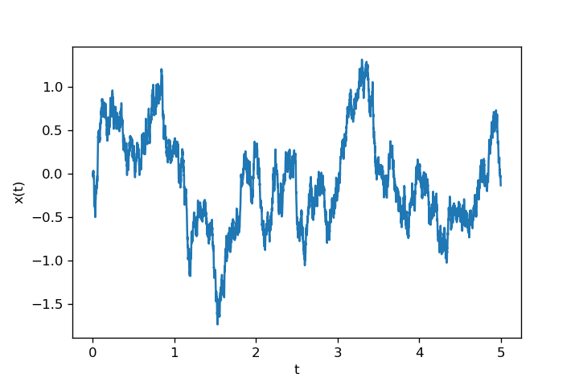

# `LSolver`: Python package for Langevin dynamics simulations

This repository contains the package `LSolver` along with example notebooks demonstrating multiple applications and tests of the package.

## Overview

The package `LSolver` is a lightweight Python tool implementing two algorithms for solving the Langevin equation in both underdamped and overdamped regimes. For the overdamped regime, it uses the traditional Euler-Maruyama discretization method. For the underdamped regime, it employs the Verlet-type algorithm from [1].

### Supported equations

Any overdamped Langevin equation(s) of the following type can be numerically solved with the method `LSolver.overdamped`:

$$
\dot x(t) = \frac{1}{\gamma}F_x(x(t),y(t),t) + [2k_B T_x(x(t),y(t),t)/\gamma]^{1/2}\ \xi_x(t),
$$

$$
\dot y(t) = \frac{1}{\gamma}F_y(x(t),y(t),t) + [2k_B T_y(x(t),y(t),t)/\gamma]^{1/2}\ \xi_y(t).
$$

Method `LSolver.underdamped` can be used for Langevin equation(s) of type

$$
m \ddot x(t) = -\gamma \dot x(t) + F_x(x(t),y(t),t) + [2\gamma k_B T_x(x(t),y(t),t)]^{1/2}\ \xi_x(t),
$$

$$
m \ddot y(t) = -\gamma \dot y(t) + F_y(x(t),y(t),t) + [2\gamma k_B T_y(x(t),y(t),t)]^{1/2}\ \xi_y(t).
$$

Lastly, the method `LSolver.mixed` handles a specific hybrid combination:

$$
\dot x(t) = \frac{1}{\gamma}F_x(x(t),y(t),t) + [2k_B T_x(x(t),y(t),t)/\gamma]^{1/2}\ \xi_x(t),
$$

$$
m \ddot y(t) = -\gamma \dot y(t) + F_y(x(t),y(t),t) + [2\gamma k_B T_y(x(t),y(t),t)]^{1/2}\ \xi_y(t).
$$

### Configuration

Dataclass `LSolver.SimulationConfig` is used for specifying the parameters of the simulation, like force functions, temperature functions, friction coefficient, mass or initial conditions, as well as the RNG for reproducibility.

## Installation

After cloning or downloading the repository to your PC, open a terminal in the root directory of the repository and run:

```bash
pip install -e .
```

This command will also install all required dependencies (which is only `numpy`).

## Quick Start

Example of solving overdamped Langevin equation with harmonic potential:

```python
import numpy as np
import matplotlib.pyplot as plt
from LSolver import SimulationConfig, overdamped

# Set up the parameters of the simulation
cfg = SimulationConfig(
    gamma = 1.0,
    Fx_func = lambda t, x, y: - 2.0 * x,
    Tx_func = lambda t, x, y: 1.0,
    t_max = 5.0,
    dt = 0.001
)

# Run the simulation with specified seed for reproducibility
rng = np.random.default_rng(123)
x, y = overdamped(cfg, rng = rng)

# Plot the results
fig, ax = plt.subplots()
ax.set(xlabel=r"t", ylabel=r"x(t)")
ax.plot(cfg.t_array, x)
```



## Examples

There are several examples of using the `LSolver` package in jupyter notebooks. Here is brief overview:

0. `00_Brownian-motion.ipynb` is simple test of two algorithms for solving Langevin equation, following lecture notes. This notebook does not use any module of `LSolver`.
1. `01_Intro.ipynb` tests the implemented Euler-Maruyama algorithm (`LSolver.overdamped`) on the example of brownian particle in harmonic potential, confronting the numerical solution with analytical solution.
2. `02_Feynmans-ratchet.ipynb` applies `LSolver.overdamped` on the famous Feynman's ratchet and pawl system, with(out) weight and with(out) cooling of the pawl, showing how this system could generate usable work for pulling the weight up.
3. `03_Stirling-engine.ipynb` applies `LSolver.overdamped` on system of brownian particle inside optical tweezers, working in Stirling-like cycles. Contains calculation of generated work and checks the Thermodynamic Uncertainty Relations.
4. `04_Underdamped.ipynb` tests the implemented Verlet-type algorithm (`LSolver.underdamped`) on several systems, namely free diffusion with friction, constant external force field and harmonic potential in stationary limit, confronting the numerical results with analytical calculations.
5. `05_TUR.ipynb` uses `LSolver.mixed` for examination of a special system of interest. This was the main goal of the project.

## Repository Structure

```plaintext
LSolver/
├── .github/workflows           <-- GitHub actions file
├── LSolver
|   ├── __init__.py
|   ├── config.py               <-- Dataclass SimulationConfig
|   └── engine.py               <-- Methods underdamped, overdamped, mixed
├── docs
|   └── api_reference.md        <-- Documentation of LSolver package
├── examples                    <-- Examples of use and notes for the SFG project
|   ├── 00_Brownian-motion.ipynb
|   ├── 01_Intro.ipynb
|   ├── 02_Feynmans-ratchet.ipynb
|   ├── 03_Stirling-engine.ipynb
|   ├── 04_Underdamped.ipynb
|   └── 05_TUR.ipynb
├── tests                       <-- tests of the package
|   ├── test_config.py
|   ├── test_physics.py
|   ├── test_reproducibility.py
|   └── test_shapes.py
├── .gitignore
├── README.md
└── pyproject.toml
```

## Acknowledgements

This work was supported by SFG MFF UK (Student Faculty Grant) under the title "Termodynamické relace neurčitosti". The author is grateful to doc. V. Holubec of KMF MFF UK for supervising the project and providing invaluable guidance and consultations.

## References

[1] Grønbech-Jensen, N., & Farago, O. (2013). A simple and effective Verlet-type algorithm for simulating Langevin dynamics. Molecular Physics, 111(8), 983–991. Available at: https://doi.org/10.1080/00268976.2012.760055